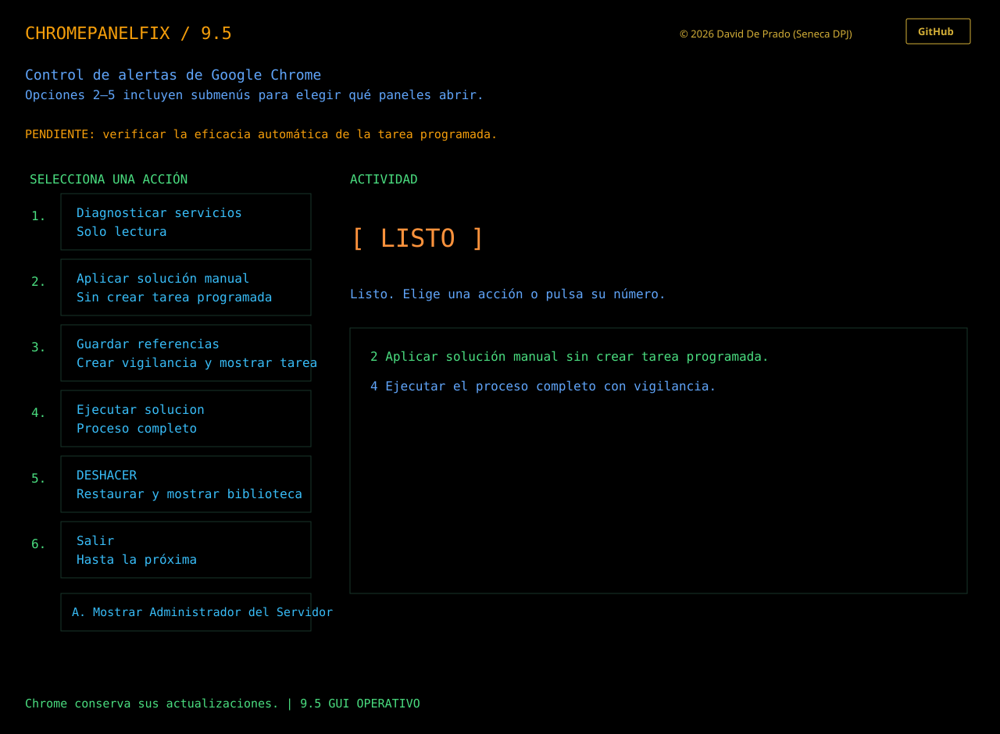
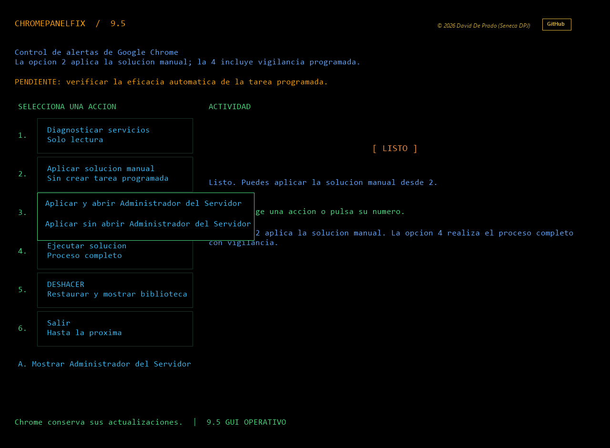
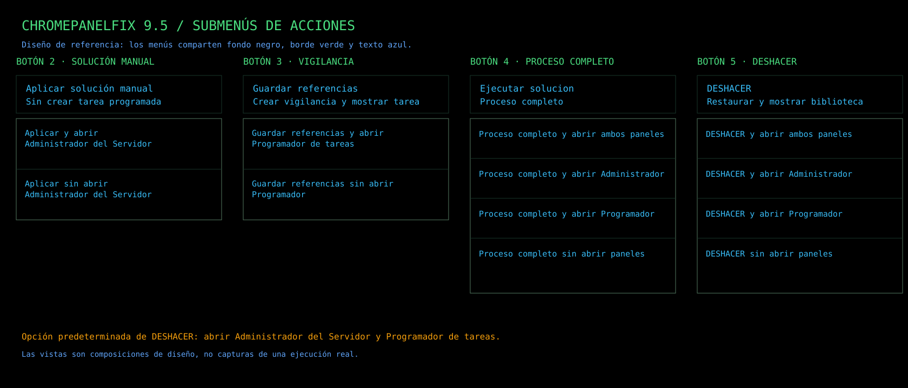

# ChromePanelFix 9.5 — GUI OPERATIVO

[Español](README.md) · [English](README.en.md)

**Limpia las alertas de servicios detenidos de Google Update en el Administrador del Servidor y conserva los componentes de actualización de Chrome.**

Utilidad gráfica en PowerShell para administradores de Windows Server. Ajusta los filtros de servicios de los paneles «Servidor local» y «Todos los servidores» en el perfil del administrador actual.

La versión 9.5 añade una aplicación manual de la solución sin crear una tarea programada. Las opciones 2–5 muestran submenús con alternativas de apertura. La opción 4 conserva el proceso completo con vigilancia programada.

## Descargar

[Descargar ChromePanelFix 9.5](https://github.com/SenecaDPJ/ChromePanelFix/releases/tag/v9.5) · [Repositorio](https://github.com/SenecaDPJ/ChromePanelFix)

## ¿Harto de este error en tus Servidores?

## Consigue un Administrador del Servidor limpio de errores recurrentes que solo generan confusión y en realidad no tienen relevancia.

## Inicio rápido

1. Descargue el ZIP de la Release 9.5 y extraiga todos sus archivos juntos, conservando la carpeta assets.
2. Abra Abrir-ChromePanelFix.cmd.
3. Si Windows marca scripts como procedentes de Internet, el lanzador pregunta si confía en ellos. Responda S para retirar Zone.Identifier solo de los archivos .ps1 marcados en esta carpeta y continuar; responda N para salir sin modificarlos.
4. Elija 2 para aplicar manualmente la solución o 4 para el proceso completo con vigilancia.

La confirmación aparece al abrir el lanzador, ya que la extracción estándar de Windows no permite añadir una pregunta personalizada del proyecto. La operación no modifica ni elude la política de ejecución de PowerShell. Si la política de la organización requiere scripts firmados, consulte al administrador.

## Funciones

| Opción | Acción |
|---|---|
| 1 | Diagnóstico de servicios y filtros, solo lectura; permite abrir Administrador del Servidor. |
| 2 | Aplicar la solución manual y guardar los datos necesarios para DESHACER. No crea ni actualiza una tarea. El submenú permite abrir Administrador del Servidor al terminar o dejarlo cerrado. |
| 3 | Guardar referencias / Crear vigilancia y mostrar tarea; el submenú permite abrir Biblioteca del Programador o dejarla cerrada. |
| 4 | Ejecutar solucion / Proceso completo; el submenú permite abrir ambos paneles, uno de ellos o ninguno. |
| 5 | DESHACER / Restaurar y mostrar biblioteca; el submenú abre ambos paneles por defecto y permite elegir Administrador del Servidor, Programador de tareas o ninguno. |
| 6 | Salir. |

La opción 2 conserva cualquier tarea de vigilancia que ya exista y avisa antes de continuar. No ejecuta si la tarea propia está en curso. DESHACER sigue retirando las exclusiones propias y la tarea propia si existe; abre los paneles elegidos después del intento para facilitar la comprobación.

La herramienta ajusta filtros del panel. No elimina ni deshabilita servicios, tareas o archivos de Google, no borra eventos y no certifica que Chrome se haya actualizado. Los fallos reales de actualización deben diagnosticarse por separado.

## Requisitos y límites

- Windows PowerShell 5.1, .NET Framework, Windows Forms, Administrador del Servidor y Programador de tareas.
- Ejecútela con la cuenta administradora cuyas preferencias del panel quiere ajustar. Los ajustes son por perfil; las operaciones necesarias solicitan elevación.
- La eficacia de las ejecuciones automáticas de la tarea y la compatibilidad con Windows Server 2016 siguen pendientes de verificación.

## Cierre de procesos

Si una ejecución se queda abierta e impide cerrar la carpeta, use Detener-Procesos-ChromePanelFix.cmd. La herramienta enumera procesos identificados como ChromePanelFix y solicita PID concretos antes de cerrarlos. No detiene Administrador del Servidor, MMC ni otros procesos de PowerShell.

## Licencia

Copyright © 2026 David De Prado (Seneca DPJ). Licencia MIT. Proyecto independiente, sin afiliación con Google ni Microsoft.
