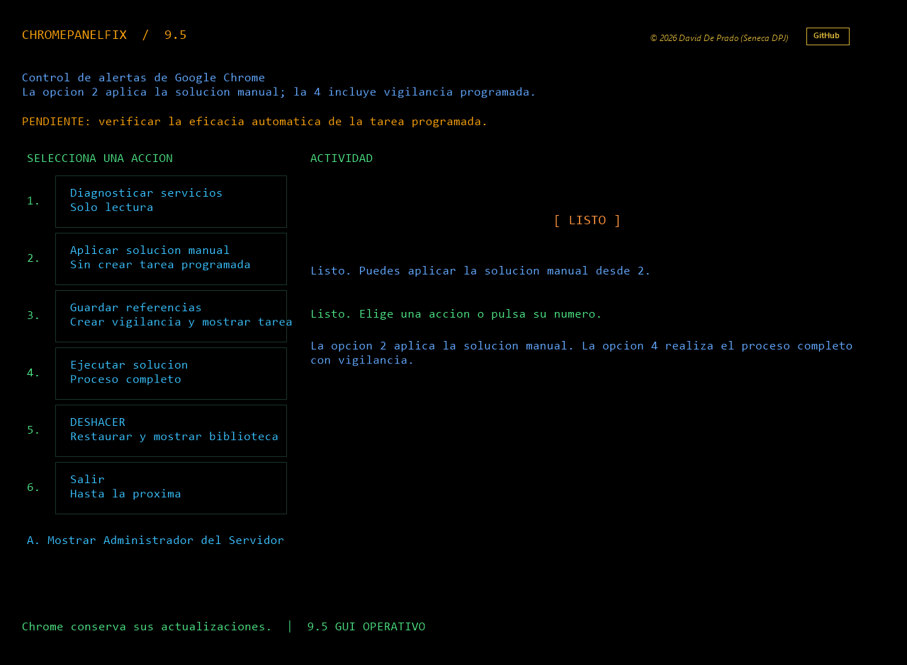

# ChromePanelFix 9.4 — GUI OPERATIVO

[Español](README.md) · [English](README.en.md)

**Limpia las alertas de servicios detenidos de Google Update en el Administrador del Servidor y conserva los componentes de actualización de Chrome.**

Utilidad gráfica en PowerShell para administradores de Windows Server. Ajusta los filtros de servicios de los paneles «Servidor local» y «Todos los servidores» en el perfil del administrador actual.

La versión 9.4 incorpora el icono de ChromePanelFix en la ventana y mantiene el flujo verificado de la 9.3.

## Descargar

[Descargar ChromePanelFix 9.4](https://github.com/SenecaDPJ/ChromePanelFix/releases/tag/v9.4) · [Repositorio](https://github.com/SenecaDPJ/ChromePanelFix)

## Inicio rápido

1. Descargue el ZIP de la Release 9.4 y extraiga todos sus archivos juntos, conservando la carpeta assets.
2. Abra Abrir-ChromePanelFix.cmd.
3. Si Windows marca scripts como procedentes de Internet, el lanzador pregunta si confía en ellos. Responda S para retirar Zone.Identifier solo de los archivos .ps1 marcados en esta carpeta y continuar; responda N para salir sin modificarlos.
4. Elija 3 para el flujo completo; no necesita ejecutar antes 1 ni 2.

La confirmación aparece al abrir el lanzador, ya que la extracción estándar de Windows no permite añadir una pregunta personalizada del proyecto. La operación no modifica ni elude la política de ejecución de PowerShell. Si la política de la organización requiere scripts firmados, consulte al administrador.

## Funciones

| Opción | Acción |
|---|---|
| 1 | Diagnóstico de servicios y filtros, solo lectura; permite abrir Administrador del Servidor. |
| 2 | Guardar referencias, crear y comprobar la tarea propia; abrir Biblioteca del Programador. |
| 3 | Aplicar exclusiones, guardar referencias, instalar y comprobar vigilancia; abrir Administrador del Servidor y Biblioteca del Programador. |
| 4 | Revertir exclusiones propias, retirar la tarea y referencias; comprobar y abrir Biblioteca del Programador. |
| 5 | Salir. |

La herramienta ajusta filtros del panel. No elimina ni deshabilita servicios, tareas o archivos de Google, no borra eventos y no certifica que Chrome se haya actualizado. Los fallos reales de actualización deben diagnosticarse por separado.

## Requisitos y límites

- Windows PowerShell 5.1, .NET Framework, Windows Forms, Administrador del Servidor y Programador de tareas.
- Ejecútela con la cuenta administradora cuyas preferencias del panel quiere ajustar. Los ajustes son por perfil; las operaciones necesarias solicitan elevación.
- La eficacia de las ejecuciones automáticas de la tarea y la compatibilidad con Windows Server 2016 siguen pendientes de verificación.

## Cierre de procesos

Si una ejecución se queda abierta e impide cerrar la carpeta, use Detener-Procesos-ChromePanelFix.cmd. La herramienta enumera procesos identificados como ChromePanelFix y solicita PID concretos antes de cerrarlos. No detiene Administrador del Servidor, MMC ni otros procesos de PowerShell.

## Licencia

Copyright © 2026 David De Prado (Seneca DPJ). Licencia MIT. Proyecto independiente, sin afiliación con Google ni Microsoft.
